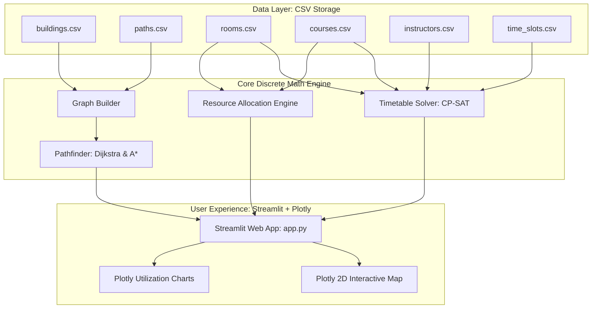

# System Architecture: Smart Campus Optimization System

Welcome to the architecture guide. This document explains how the entire system is designed and how the components interact in clear, beginner-friendly terms.

---

## 1. High-Level Overview

The system is designed as a **three-tier modular architecture**:
1. **Data Layer (Storage)**: Plain CSV files storing physical campus entities (buildings, walkways, rooms, courses, instructors, time slots).
2. **Computational Engine Layer (Discrete Mathematics & Optimization)**:
   - **Navigation Module**: NetworkX graph algorithms (Dijkstra and A*).
   - **Scheduling Module**: Google OR-Tools CP-SAT constraint satisfaction engine.
   - **Allocation Module**: Resource utilization and capacity matching analytics.
3. **User Interface Layer (Visualization & Interaction)**: Streamlit web interface with interactive Plotly canvas drawings.

---

## 2. Component Breakdown

### A. Graph Builder (`src/navigation/graph_builder.py`)
- **Purpose**: Reads `buildings.csv` (nodes) and `paths.csv` (edges) and builds an in-memory graph $G = (V, E, w)$ using NetworkX.
- **Why NetworkX?**:
  - Pure Python, reliable, and standardized for graph data structures.
  - Allows custom node metadata (coordinates, categories) and edge attributes (distances, accessibility).
- **Subgraphs**: Provides `get_accessible_subgraph()` by filtering out non-accessible edges (e.g. stairs), creating an edge-induced subgraph $G' = (V, E')$ where $\forall e \in E', \text{is\_accessible}(e) = \text{True}$.

### B. Pathfinder (`src/navigation/pathfinder.py`)
- **Purpose**: Calculates shortest walking routes and measures search complexity.
- **Algorithms**:
  - **Dijkstra's Algorithm**: Guarantees the shortest path by systematically exploring outward.
  - **A\* Algorithm**: Uses Euclidean distance as an admissible heuristic to guide the search towards the goal, expanding fewer nodes.
- **Output**: Returns ordered path sequence, total distance in meters, estimated walking time (minutes), and nodes explored.

### C. Visualizer (`src/utils/visualizer.py`)
- **Purpose**: Generates interactive 2D maps without requiring heavy GIS or paid mapping APIs (e.g., Google Maps API).
- **Technology**: **Plotly Graph Objects** (`go.Scatter`).
- **Features**:
  - Nodes positioned at physical coordinates $(x, y)$.
  - Walkways represented as lines with length annotations.
  - Optimal paths highlighted in high-visibility orange with numbered stop markers.

---

## 3. Key Design Decisions & Why We Made Them

| Design Decision | Choice | Alternative Considered | Why This Choice Is Better for Beginners |
| :--- | :--- | :--- | :--- |
| **Data Storage** | Plain CSV Files | SQLite / PostgreSQL | CSV files can be inspected and edited directly in Excel or Notepad without installing database servers. |
| **Web Framework** | Streamlit | Flask / Django / React | Streamlit allows 100% Python code with automatic reactive UI and zero frontend (HTML/CSS/JS) complexity. |
| **Mapping Engine** | Plotly 2D Scatter | Leaflet / Google Maps API | No API keys, no billing, no internet connection required at runtime; works entirely offline and accurately renders mathematical coordinates. |
| **Optimization Tool** | Google OR-Tools CP-SAT | Custom backtracking recursion | CP-SAT uses modern SAT-solving techniques that solve timetables in milliseconds rather than freezing or crashing with infinite loops. |

